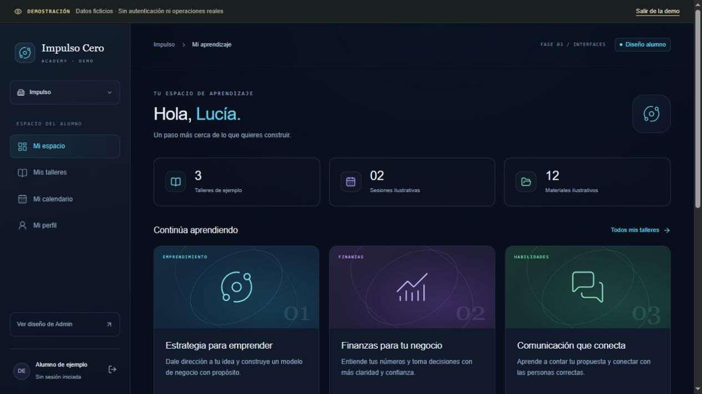

# Fase 3 — Implementación inicial

Fecha: 30 de octubre de 2026, America/Lima.

## 1. Resultado y ubicación

Proyecto independiente creado en `C:\Users\Delfi\Desktop\SistemaAlumnos-Web`, como carpeta hermana del proyecto Apps Script. No se copió su carpeta, historial, configuración, identificadores privados ni credenciales. No se ha creado un repositorio remoto ni realizado un despliegue.

La aplicación utiliza Next.js App Router, React y TypeScript estricto. Hay siete interfaces principales navegables en una sección pública de demostración, más las estructuras de módulos pendientes. No hay Landing comercial, autenticación simulada, cuenta administrativa real ni operaciones sensibles.

El proyecto original conserva sus 20 archivos exactamente como estaban al comenzar esta fase: 17 fuentes/configuraciones y tres documentos anteriores. La comparación SHA-256 no detectó cambios, eliminaciones ni archivos añadidos dentro de esa carpeta.

## 2. Estructura creada

```text
SistemaAlumnos-Web/
  src/app/                       Rutas App Router
    (auth)/login/                Diseño de login sin ingreso activo
    (workspace)/                 Rutas reales cerradas, sin datos
    demo/                        Selector y vistas públicas sintéticas
  src/components/
    layouts/                     Shell, navegación y aviso persistente de demo
    ui/                          Badges, cabeceras, estados, tablas y diálogo
  src/features/
    auth/ organizations/ dashboard/ admin/
    students/ courses/ enrollments/ lessons/
    announcements/ materials/ calendar/ certificates/
    preview/                     Fixtures y navegación independientes de Auth
  src/lib/
    auth/ authorization/         Sesión no configurada y reglas de dominio
    supabase/                    Factories servidor/navegador deshabilitadas
    data/                        Contratos y adaptadores unavailable
  src/styles/                    Estilos globales mínimos
  src/types/                     Props de rutas
  tests/                         3 suites, 26 pruebas
  scripts/                       Next con telemetría desactivada y chequeo HTTP
  docs/SEGURIDAD_Y_RLS.md
  docs/screenshots/dashboard.jpg
  README.md
  FASE_3_IMPLEMENTACION.md
  .env.example                   Solo nombres vacíos
  .gitignore, .npmrc, .nvmrc
  package.json, package-lock.json
  next.config.ts, tsconfig.json, eslint.config.mjs, vitest.config.ts
```

Los estilos de pantallas y componentes usan CSS Modules. No se generaron tipos falsamente atribuidos a una base existente ni migraciones SQL productivas. Los DTO se escribieron como contratos de aplicación, a partir de la planificación.

## 3. Versiones y compatibilidad

Entorno utilizado: Node.js **26.10.0**, npm **11.19.1**, Windows PowerShell. `.nvmrc` fija Node 26.10.0; el manifiesto permite Node 24.x o 26.x. Node 24 no fue probado en este equipo.

| Paquete                   | Versión exacta |
| ------------------------- | -------------- |
| @eslint/js                | 10.0.1         |
| @next/eslint-plugin-next  | 16.4.3         |
| @supabase/ssr             | 0.12.7         |
| @supabase/supabase-js     | 2.118.0        |
| @types/node               | 26.6.6         |
| @types/react              | 19.3.0         |
| @types/react-dom          | 19.3.0         |
| eslint                    | 10.14.0        |
| eslint-plugin-react-hooks | 7.1.1          |
| lucide-react              | 1.65.0         |
| next                      | 16.4.3         |
| prettier                  | 3.6.2          |
| react                     | 19.3.1         |
| react-dom                 | 19.3.1         |
| server-only               | 0.0.1          |
| typescript                | 5.9.3          |
| typescript-eslint         | 8.72.1         |
| vitest                    | 5.0.5          |

Dependencias directas con versiones exactas, sin rangos; dependencias transitivas fijadas en `package-lock.json`. Se comprobó una instalación limpia mediante `npm ci --ignore-scripts`, sin conflictos finales de peers. TypeScript 5.9.3 se eligió por compatibilidad con el conjunto de lint, en lugar de asumir que la última versión mayor del compilador es compatible con todos los plugins.

ESLint utiliza el plugin oficial de Next, typescript-eslint y React Hooks directamente. Se evitó combinar ESLint 10 con plugins transitivos de eslint-config-next que todavía limitaban sus peers a ESLint 9. No se fuerza la instalación mediante --force o --legacy-peer-deps.

Los paquetes Supabase están instalados para preparar interfaces, pero no se inicializan clientes ni se realizan conexiones. Las factories lanzan `IntegrationUnavailableError` antes de cualquier operación, incluso con variables presentes.

## 4. Rutas implementadas

### Rutas reales preparadas

- `/login`: interfaz de acceso; campos y botón deshabilitados.
- `/seleccionar-organizacion`: acceso pendiente, sin revelar membresías.
- `/o/[organizationSlug]/dashboard`
- `/o/[organizationSlug]/dashboard/cursos`
- `/o/[organizationSlug]/dashboard/calendario`
- `/o/[organizationSlug]/admin`
- `/o/[organizationSlug]/admin/alumnos`
- `/o/[organizationSlug]/admin/cursos`
- `/o/[organizationSlug]/admin/clases`
- `/o/[organizationSlug]/admin/avisos`
- `/o/[organizationSlug]/admin/materiales`
- `/o/[organizationSlug]/admin/calendario`
- `/o/[organizationSlug]/admin/certificados`

También se preparó `/o/[organizationSlug]/dashboard/perfil`. `/` redirige a `/login`.

Todas las rutas de espacio real muestran **acceso aún no habilitado**, sin datos ni permisos. El lector de sesión devuelve `unconfigured`; no acepta roles/cookies/parámetros como credenciales. `?demo=true&role=admin` no cambia ese resultado. Esto es una frontera cerrada mientras no exista integración, no una implementación completa de seguridad productiva.

### Rutas de demostración

- `/demo`: selector de conjuntos ficticios, con enlaces explícitos a ambos diseños.
- `/demo/o/impulso/dashboard` y sus rutas de talleres, calendario y perfil.
- `/demo/o/impulso/admin` y sus siete secciones administrativas.
- Las mismas vistas con `incubadora`, usando otro conjunto de fixtures.
- `/demo/o/impulso/dashboard/cursos/estrategia-emprendedora`: ejemplo de detalle navegable, sin reproducción ni descargas.

El encabezado persistente identifica la demostración, y los componentes explican el carácter ficticio de sus cifras. No se selecciona un rol Auth: navegar a un diseño administrativo público no inicia sesión ni modifica pertenencias.

Slugs/secciones desconocidas y detalles de cursos en borrador no se renderizan como contenido de alumno; responden 404. Se corrigió el streaming inicial que devolvía HTTP 200 para una página visualmente no encontrada.

## 5. Componentes visuales construidos

| Interfaz                              | Contenido de la primera versión                                                                                    |
| ------------------------------------- | ------------------------------------------------------------------------------------------------------------------ |
| Login                                 | Identidad visual, estado de integración, campos deshabilitados y enlace separado a demo.                           |
| Selector de organización              | Dos tarjetas ficticias, explicación de aislamiento y accesos a diseños alumno/Admin.                               |
| Dashboard                             | Sidebar, navegación móvil, saludo de ejemplo, indicadores, tarjetas con arte CSS/SVG, avisos y agenda ilustrativa. |
| Talleres del alumno                   | Búsqueda insensible a acentos, catálogo de publicados y detalle ilustrativo.                                       |
| Resumen Admin                         | Indicadores, alumnos de ejemplo y accesos a las secciones.                                                         |
| Alumnos                               | Tabla responsive, búsqueda por contacto/nombre, filtros, ficha y formulario nuevo de solo lectura.                 |
| Talleres Admin                        | Tabla, búsqueda, filtro publicados/borradores y ficha/formulario de solo lectura.                                  |
| Agenda                                | Estructura semanal compartida para alumno/Admin, sin eventos conectados ni edición.                                |
| Clases/avisos/materiales/certificados | Rutas navegables y estados vacíos con responsabilidades y límites claros.                                          |

La referencia original se reinterpretó: navy oscuro, acentos celestes/violetas/verdes, sidebar y jerarquías de tarjetas. No se copiaron scripts globales, controladores, innerHTML, credenciales ni llamadas google.script.run. No se cargan fuentes, videos, imágenes o scripts desde CDN. Iconos mediante lucide-react; recursos gráficos mediante CSS/SVG de interfaz.

## 6. Pruebas y resultados

| Verificación ejecutada                                                         | Resultado                                                                                                                                                |
| ------------------------------------------------------------------------------ | -------------------------------------------------------------------------------------------------------------------------------------------------------- |
| `npm ci --ignore-scripts` con el lockfile final                                | Correcto, dependencias instaladas sin conflictos finales.                                                                                                |
| `npm run lint`                                                                 | Correcto, cero errores/advertencias, --max-warnings=0.                                                                                                   |
| `npm run typecheck`                                                            | Correcto, TypeScript estricto, noUncheckedIndexedAccess y exactOptionalPropertyTypes.                                                                    |
| `npm run test`                                                                 | **26 pruebas aprobadas en 3 archivos**.                                                                                                                  |
| `npm run build`                                                                | Correcto; compilación optimizada y comprobación de tipos de Next.                                                                                        |
| `npm run check`                                                                | Correcto de principio a fin sobre las fuentes finales.                                                                                                   |
| `npm run check:routes` con servidor de compilación local                       | **55 rutas/comprobaciones aprobadas**, incluidas cabeceras, rutas reales sin bypass, demos de dos organizaciones y 404.                                  |
| `npm run format:check`                                                         | Comprobado con Prettier sobre fuentes/documentación entregadas.                                                                                          |
| `npm audit --omit=dev`                                                         | Cero avisos conocidos comunicados por npm para dependencias de ejecución en la consulta de esta fase; no equivale a una auditoría completa del producto. |
| Comparación SHA-256 del origen                                                 | Los **20 archivos anteriores intactos**; cero cambios o añadidos en Apps Script.                                                                         |
| Búsqueda local de credenciales/identificadores heredados en las nuevas fuentes | Sin coincidencias de los valores sensibles extraídos como referencia en memoria; no se reproducen en el informe.                                         |

Las pruebas unitarias cubren denegación sin identidad, perfil/membresía/organización inactivos, tenant ajeno, perfil ajeno, rol insuficiente y MFA administrativo; parser de rutas, aislamiento de fixtures, búsquedas con acentos y renderizado seguro de texto; clientes deshabilitados y repositorios que devuelven unavailable, nunca datos sintéticos como fallback de una consulta real.

### Revisión de navegador

Se verificó en navegador local:

- Navegación alumno → diseño Admin y entrada a las secciones.
- Búsqueda `lucia` encuentra a Lucía sin depender del acento.
- Ficha de alumno abierta mediante diálogo nativo; campos y botón de guardado deshabilitados, cierre disponible.
- Filtro Borradores de talleres devuelve solo el registro correspondiente, sin tocar matrículas.
- Login sin campos/botón de ingreso activos y enlace distinto al selector público.
- Cambio de fixture a Incubadora muestra su alumna y sus talleres, sin mezclar el conjunto Impulso.
- Diseño de escritorio y viewport móvil de 390 × 844; no hubo desbordamiento horizontal de la página. Tablas y navegación conservan su scroll interno.
- No se observaron errores o advertencias de consola en esas interacciones.

Estas comprobaciones de navegador fueron interactivas, no una suite Playwright instalada en el repositorio. Las 55 verificaciones HTTP sí quedan reproducibles en `scripts/check-routes.mjs`. No se ejecutaron pruebas de PostgreSQL/RLS, puesto que no existe conexión/esquema en esta fase.



## 7. Qué permanece simulado o no implementado

- Nombres/contactos, cursos, indicadores, progreso, estados y agenda del inicio son sintéticos. Los contactos utilizan example.test; no corresponden a cuentas reales.
- La biblioteca de alumno representa un ejemplo; no resuelve matrículas reales.
- No existen login funcional, registro, invitación, MFA operativo, recuperación ni sesiones de proveedor.
- No hay altas, bajas, publicación, edición, matrícula, subida/descarga, reproducción o emisión de certificados reales.
- No hay base PostgreSQL, políticas RLS ejecutadas, migraciones SQL productivas, Google Sheets, Drive ni fuentes originales conectadas.
- No hay login unificado, cuentas administrativas, envío de correos, repositorio remoto ni despliegue.

Los estados de vista pueden filtrarse/buscarse en memoria; no se guarda esa interacción como cambios de negocio, no se emite un éxito ficticio y no hay endpoints mutantes.

## 8. Preparación de Supabase y próximos pasos

1. Confirmar propiedad de organizaciones/datos y reglas pendientes de la fase 2.
2. Diseñar e implementar migraciones **locales/de prueba** con perfiles, membresías, matrículas, FKs compuestas, estados, auditoría y RLS/grants; ejecutar pruebas negativas y positivas antes de datos reales.
3. Sustituir de forma explícita los adaptadores unavailable por SSR de Auth y cliente de usuario. Validar identidad en servidor, resolver pertenencia vigente y construir contexto autorizado después de esas verificaciones.
4. Completar invitaciones/activación verificadas, recuperación, MFA administrativo, cookies/callbacks, CSRF, caché y observabilidad. No habilitar roles por dominio o metadata editable; no importar hashes/sesiones antiguos.
5. Implementar consultas/mutaciones por dominio y transacciones con versión; cambios personales y cambios de matrícula separados. Las guardias actuales no sustituyen las futuras políticas DB.
6. Añadir Storage privado y autorización de recursos/URLs temporales, luego calendario conciliado y certificados según elegibilidad aprobada.
7. Ensayar importación con staging/procedencia e idempotencia; mantener un solo escritor y corte autorizado posterior. No reutilizar controladores inseguros.
8. Solo después de validación y nueva instrucción: conectar los entornos autorizados y preparar despliegue. El login unificado continúa pendiente de contrato con ambos aplicativos.

## 9. Ejecución local y revisión

```powershell
Set-Location -LiteralPath 'C:\Users\Delfi\Desktop\SistemaAlumnos-Web'
npm ci --ignore-scripts
npm run dev
```

Abrir [login](http://127.0.0.1:3000/login) o [selector de demostración](http://127.0.0.1:3000/demo). En esta entrega se inició además un servidor de revisión de la compilación en loopback, puerto 3000. Si sigue activo al iniciar otro servidor, consultar el puerto que imprime Next; puede elegir 3001. No es un despliegue público.

Para compilar y servir localmente:

```powershell
npm run check
npm run start
```

No iniciar dos servidores en el mismo puerto. Con el servidor local ya activo, otra terminal puede ejecutar `npm run check:routes`. El README enumera todas las rutas y comandos adicionales.
